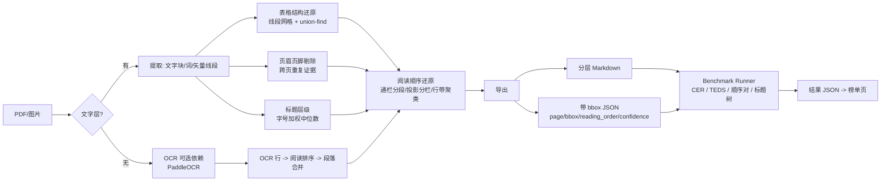

# docforge

**中文文档解析引擎与公开 Benchmark：把多栏、复杂表格、扫描件 PDF 转成 LLM-ready 的分层 Markdown 和带 bbox 可溯源的 JSON，并配套一个可复现的中文解析评测基准。**

<p align="center">
  <a href="#-benchmark-榜单"></a>
  <a href="LICENSE"></a>
  
  <a href="https://github.com/OWNER/docforge/actions"></a>
</p>

<!-- 首屏 demo 位：放一张「扫描/复杂表格 PDF → 还原结果」前后对比 GIF。
     建议内容：examples 里的财报表格 PDF 左侧原图、右侧渲染出的 Markdown/HTML 表格，
     用 vhs 或 ScreenToGif 录制 10~15 秒。路径约定：docs/assets/demo.gif -->

## 为什么是 docforge

- 文档解析是所有 RAG 的地基，但中文场景（扫描公文、财报合并单元格、双栏论文）没有公认的开源强方案；
- markitdown / PyMuPDF4LLM 这类文字层提取器**不做版面理解**：双栏论文会被逐行交错、合并单元格直接拍平；
- 更重要的是：**解析引擎会被追上，被引用的评测标准不会**。docforge 附带一个确定性指标、带提交校验的公开 benchmark，任何方案（包括 VLM 路线）都可以来打榜。

## 30 秒 Quick Start

```bash
# 1) 安装（核心依赖极轻：PyMuPDF + jsonschema）
pip install -e .
# 2) 生成合成种子数据集（程序化 PDF，GT 精确已知，用于打通评测链路）
docforge gen-seed
# 3) 解析一个多栏+表格的 PDF
docforge convert benchmark/data/synthetic/inputs/mixed-001.pdf -o out.md --format both
# 4) 在种子集上跑评测（自研引擎 + 可用基线），得到 report.md 与榜单页
docforge bench --engine docforge --engine pymupdf4llm
docforge leaderboard --results results/ --out leaderboard/index.html
```

扫描件 OCR 为可选能力：`pip install "docforge[ocr]"`（拉起 PaddleOCR，首次运行自动下载模型）。

Docker（含 OCR 全量依赖，镜像已实测可跑）：

```bash
docker build -t docforge .
docker run --rm -v "$PWD:/data" docforge convert /data/扫描件.pdf -o /data/out.md
```

## 特性

| 能力 | 状态 | 说明 |
|---|---|---|
| 数字版 PDF → Markdown / JSON | ✅ v0.1 | 文字层直提取，毫秒级；标题层级 + 跨页段落续接 |
| 双栏/多栏阅读顺序还原 | ✅ v0.1 | 通栏分段 → x 投影分栏 → 行带聚类，纯几何可单测 |
| 有框线表格结构还原 | ✅ v0.1 | 线段网格聚类 + union-find 合并，输出 rowspan/colspan HTML |
| 扫描件 OCR | 🔌 可选 | `docforge[ocr]`（PaddleOCR 2.x/3.x 双代适配）；扫描页表格结构 v0.2 |
| 公式 → LaTeX | ⏳ v0.2 | 指标已实现并入库，转换链路未启用（诚实声明，见「不足」） |
| Benchmark（4 指标 + schema 校验 + 榜单） | ✅ v0.1 | CER / TEDS / 阅读顺序 / 标题树，全部确定性指标，无 LLM judge |
| 人工标注工作流 | 🚧 进行中 | 预标注 + 双人一致性工具（`docforge annotate` / `docforge bench-agree`） |
| CLI / Docker / FastAPI | ✅ / ✅ / ✅ | 同步 `/convert`；异步任务队列 v0.2 |

## 架构



核心算法（值得读源码的部分，均带面试点注释）：

- **阅读顺序**：[docforge/stages/reading_order.py](docforge/stages/reading_order.py) —— 通栏块先剥离再分栏；行带容差取 0.5×块高中位数；
- **表格结构**：[docforge/stages/table.py](docforge/stages/table.py) —— 局部边界缺失经 union-find 汇成跨行列区域；L 形合并的降级策略；
- **指标**：[benchmark/metrics/teds.py](benchmark/metrics/teds.py) 与 [benchmark/metrics/tree_edit.py](benchmark/metrics/tree_edit.py) —— Zhang-Shasha 树编辑距离自研实现 + 单测。

## Benchmark 榜单

数据集版本：`docforge-zh-synthetic-v0.1`（合成种子集，**不是真实分布**，用于评测链路自证与回归；人工标注集 v0.1 标注中，见 [docs/benchmark.md](docs/benchmark.md)）。

| 引擎 | 文本 1−CER ↑ | 阅读顺序对准确率 ↑ | 表格 TEDS ↑ | 标题树相似度 ↑ | 综合 ↑ |
|---|---|---|---|---|---|
| docforge 0.1.0 | 1.0000 | 1.0000 | 1.0000 | 1.0000 | **1.0000** |
| PyMuPDF4LLM | 0.9773 | 1.0000 | 1.0000 | 0.6296 | 0.9017 |
| markitdown | 0.8389 | 0.9524 | 0.9726 | 0.4445 | 0.8021 |

> 复现命令：`docforge gen-seed && docforge bench --engine docforge --engine pymupdf4llm --engine markitdown && docforge leaderboard --results results --out leaderboard/index.html`（每样本耗时与逐项分数见 `results/report.md`；测试环境：Windows 11 / Python 3.12 / CPU）。
> ⚠️ 合成集数字只证明"评测链路工作正常 + 引擎在构造样例上正确"，**不构成对真实文档的性能主张**。
>
> 两个值得注意的诚实信号：
> - **PyMuPDF4LLM 在表格 TEDS 上与我们打平**（1.0000）：它能从 PDF 单元格拓扑恢复结构，只是不输出 rowspan/colspan 属性——对有框线表格，我们的差异化在扫描件支持、置信度与 HTML 语义，而不是"有框线数字表格"本身；
> - markitdown 在双栏样本上文本分 0.32（逐行左右交错），这正是方案定位所针对的痛点，实测坐实。

## Benchmark 设计要点（为什么可信）

1. **确定性指标**：CER、TEDS（树编辑距离）、有序对准确率、标题树相似度——无 LLM judge，同输入必得同分；
2. **归一化先约定**：NFKC → 小写 → 去空白，规则最小化并开源（[benchmark/normalize.py](benchmark/normalize.py)），防止全半角/空白差异污染数字；
3. **提交格式即契约**：JSON Schema 公布，CI 校验（[benchmark/schema.py](benchmark/schema.py)），块粒度与对齐规则显式化；
4. **标注质量自证**：双人独立标注 + `docforge bench-agree` 一致性报告；标注协议见 [docs/benchmark.md](docs/benchmark.md)。

## 快速上手（开发者）

```bash
git clone https://github.com/OWNER/docforge && cd docforge
python -m venv .venv && source .venv/Scripts/activate   # Windows Git Bash
pip install -e ".[dev,bench]"
pytest            # 全部单测 + 集成测试
ruff check docforge benchmark
```

## 已知不足（诚实清单）

- **无框线表格不支持**：v0.1 只承诺有框线表格；无框线需要检测模型（PP-Structure/SLANet），在 v0.2 路线图上；
- **扫描页表格结构不支持**：扫描页没有矢量线段，几何法失效；需要图像形态学或表格识别模型，v0.2；
- **公式只检测不转换**：LaTeX 识别（pix2tex 类）对中文混排准确率未实测，v0.1 不启用，避免给不可信数字；
- **OCR 依赖 pin 在 paddle 2.x 稳定组合，推理在本机开发环境未跑通**：实测 paddlepaddle 3.x 的 onednn 推理有上游 bug（PIR 属性转换未实现，已复现并记录）；pin 到 2.6 稳定组合后，在 AMD Zen3 + WSL2/Docker 环境又遇 SIGILL（疑似其内置 oneDNN JIT 在 AMD 的问题）。适配层代码（2.x/3.x 双代探测）已就绪并经容器验证可加载模型，模型推理验证需要在标准 Intel 云环境跑一次——这是发布 v0.1 前的遗留验证项。
- **合成种子集 ≠ 真实基准**：人工标注的 100 页真实集在标注流程中；
- **标题判定是字号启发式**：对"小标题大正文"的反转版式会漏；版面检测模型在 v0.2；
- **PaddleOCR 模型文件不进镜像/仓库**：首次运行需联网下载（约几百 MB）。

## Contributing

见 [CONTRIBUTING.md](CONTRIBUTING.md)。benchmark 提交与榜单规则见 [docs/benchmark.md](docs/benchmark.md)。

## License

[MIT](LICENSE)
