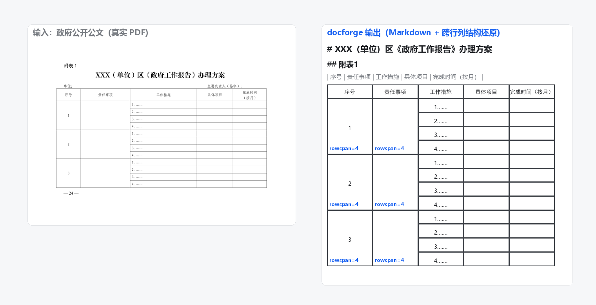
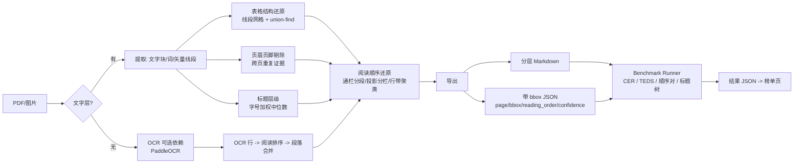

# docforge

[English](README_EN.md) | 中文

**中文文档解析引擎与公开 Benchmark：把多栏、复杂表格、扫描件 PDF 转成 LLM-ready 的分层 Markdown 和带 bbox 可溯源的 JSON，并配套一个可复现的中文解析评测基准。**

<p align="center">
  <a href="#-benchmark-榜单"></a>
  <a href="LICENSE"></a>
  
  <a href="https://github.com/attnstack/docforge/actions"></a>
</p>

<p align="center">
  
</p>

## 为什么是 docforge

- 文档解析是所有 RAG 的地基，但中文场景（扫描公文、财报合并单元格、双栏论文）没有公认的开源强方案；
- markitdown / PyMuPDF4LLM 这类文字层提取器**不做版面理解**：双栏论文会被逐行交错、合并单元格直接拍平；
- 更重要的是：**解析引擎会被追上，被引用的评测标准不会**。docforge 附带一个确定性指标、带提交校验的公开 benchmark，任何方案（包括 VLM 路线）都可以来打榜。

## 30 秒 Quick Start

```bash
# 1) 安装（已发布 PyPI；核心依赖极轻：PyMuPDF + jsonschema）
pip install docforge-zh
# 2) 生成合成种子数据集（程序化 PDF，GT 精确已知，用于打通评测链路）
docforge gen-seed
# 3) 解析一个多栏+表格的 PDF
docforge convert benchmark/data/synthetic/inputs/mixed-001.pdf -o out.md --format both
# 4) 在种子集上跑评测（自研引擎 + 可用基线），得到 report.md 与榜单页
docforge bench --engine docforge --engine pymupdf4llm
docforge leaderboard --results results/ --out leaderboard/index.html
```

从源码安装：`git clone https://github.com/attnstack/docforge && cd docforge && pip install -e .`

扫描件 OCR 为可选能力：`pip install "docforge[ocr]"`（拉起 PaddleOCR，首次运行自动下载模型）。

Docker（含 OCR 全量依赖，镜像已实测可跑）：

```bash
docker build -t docforge .
docker run --rm -v "$PWD:/data" docforge convert /data/扫描件.pdf -o /data/out.md
```

## 特性

| 能力 | 状态 | 说明 |
|---|---|---|
| 数字版 PDF → Markdown / JSON | ✅ v0.2 | 文字层直提取，毫秒级；标题层级 + 跨页段落续接；页范围 `--pages`、加密 `--password`、URL 直输 |
| 双栏/多栏阅读顺序还原 | ✅ v0.1 | 通栏分段 → x 投影分栏 → 行带聚类，纯几何可单测 |
| 有框线表格结构还原 | ✅ v0.1 | 线段网格聚类 + union-find 合并，输出 rowspan/colspan HTML |
| 扫描件 OCR | 🔌 可选 | `docforge[ocr]`（PaddleOCR 2.x/3.x 双代适配），Windows 原生实测：扫描公文页文本 0.9931；扫描页标题识别 ✅ v0.2；扫描页表格结构 v0.2+ |
| 公式 → LaTeX | ⏳ v0.2 | 指标已实现并入库，转换链路未启用（诚实声明，见「不足」） |
| Benchmark（4 指标 + schema 校验 + 榜单） | ✅ v0.1 | CER / TEDS / 阅读顺序 / 标题树，全部确定性指标，无 LLM judge |
| 人工标注工作流 | 🚧 进行中 | 预标注 + 双人一致性工具（`docforge annotate` / `docforge bench-agree`） |
| CLI / Docker / FastAPI | ✅ / ✅ / ✅ | 同步 `/convert`；异步任务队列 v0.2 |

## 架构



核心算法（值得读源码的部分）：

- **阅读顺序**：[docforge/stages/reading_order.py](docforge/stages/reading_order.py) —— 通栏块先剥离再分栏；行带容差取 0.5×块高中位数；
- **表格结构**：[docforge/stages/table.py](docforge/stages/table.py) —— 局部边界缺失经 union-find 汇成跨行列区域；L 形合并的降级策略；
- **指标**：[benchmark/metrics/teds.py](benchmark/metrics/teds.py) 与 [benchmark/metrics/tree_edit.py](benchmark/metrics/tree_edit.py) —— Zhang-Shasha 树编辑距离自研实现 + 单测。

## Benchmark 榜单

两个数据集，口径均为确定性四指标（详见 [docs/benchmark.md](docs/benchmark.md)）：

### ① 真实公文集 `docforge-zh-real-v0.1-rc`（7 样本：5 数字页 + 2 仿真扫描页）

来源：政府公开公文（依《著作权法》第五条可再分发，来源 URL 见 manifest）。GT 文本取自 PDF 文字层并逐块与原文程序化核对，结构（标题层级/表格跨行列）由标注员读渲染图核定；**已完成第二轮独立复核（仅依据渲染图重标），文本一致率 1.0000、结构零分歧（[AGREEMENT.md](benchmark/data/real-v0.1-rc/AGREEMENT.md)）；单标注员两轮，升 v0.1 需第二位标注员**。

| 引擎 | 文本 1−CER ↑ | 阅读顺序 ↑ | 表格 TEDS ↑ | 标题树 ↑ | 综合 ↑ |
|---|---|---|---|---|---|
| docforge 0.2.0（含 OCR） | 0.8760 | 0.9762 | 0.6667 | 0.9524 | **0.8678** |
| PyMuPDF4LLM | 0.5331 | 1.0000 | 0.2044 | 0.5952 | 0.5832 |
| markitdown | 0.3576 | 0.9667 | 0.0000 | 0.3333 | 0.4144 |

> 复现：`docforge bench --engine docforge --engine pymupdf4llm --engine markitdown --dataset benchmark/data/real-v0.1-rc --out results-real`（docforge 需 `pip install "docforge[ocr]"`）
> 诚实解读（重要）：
> - 数字页（5 样本）docforge 全指标 1.0：文本指标对"文字层提取类"引擎区分度低（GT 与引擎同源于文字层，1.0 是预期而非奇迹），区分度在结构——真实公文的跨行合并表格（rowspan=4×3 组、colspan 备注行）与"黑体/楷体同字号标题"，两个基线均无法还原；
> - 扫描页（2 样本）：扫描公文页 OCR 文本 0.9931、阅读顺序 1.0；标题树 0.667/1.0 来自 v0.2.0 的扫描页标题识别（OCR 行高代理）——同一数据集在 v0.1.0 上这两项为 0.333/0.333，综合分 0.8321 → 0.8678，提升全部来自扫描页标题这一项；扫描表格页 text 0.139 / table 0.0 仍是**已声明的边界**——扫描页无矢量线，表格结构不可还原，退化文本混入正文也被 GT 判罚，两项负分如实计入总分；
> - docforge 真实集数字基于 7 个样本，样本量小，不外推为整体性能主张；标题判定依赖公文格式先验（黑体/楷体/编号模式），对非公文版式的泛化未验证。

### ② 合成种子集 `docforge-zh-synthetic-v0.1`（10 样本，评测链路自证与回归）

| 引擎 | 文本 1−CER ↑ | 阅读顺序 ↑ | 表格 TEDS ↑ | 标题树 ↑ | 综合 ↑ |
|---|---|---|---|---|---|
| docforge 0.1.0 | 1.0000 | 1.0000 | 1.0000 | 1.0000 | **1.0000** |
| PyMuPDF4LLM | 0.9773 | 1.0000 | 1.0000 | 0.6296 | 0.9017 |
| markitdown | 0.8389 | 0.9524 | 0.9726 | 0.4445 | 0.8021 |

> 复现：`docforge gen-seed && docforge bench --engine docforge --engine pymupdf4llm --engine markitdown && docforge leaderboard --results results --out leaderboard/index.html`（每样本耗时与逐项分数见 `results/report.md`；测试环境：Windows 11 / Python 3.12 / CPU）
> ⚠️ 合成集数字只证明"评测链路工作正常 + 引擎在构造样例上正确"，**不构成对真实文档的性能主张**。
>
> 对对比结果的两点说明：
> - **PyMuPDF4LLM 在合成集表格 TEDS 上与我们打平**（1.0000）：它能从 PDF 单元格拓扑恢复结构，只是不输出 rowspan/colspan 属性——在真实集的复杂表格上它掉到 0.2044，差距来自跨行列合并的真实复杂度；
> - markitdown 在双栏样本上文本分 0.32（逐行左右交错），这正是方案定位所针对的痛点，实测坐实。

## Benchmark 设计要点（为什么可信）

1. **确定性指标**：CER、TEDS（树编辑距离）、有序对准确率、标题树相似度——无 LLM judge，同输入必得同分；
2. **归一化先约定**：NFKC → 小写 → 去空白，规则最小化并开源（[benchmark/normalize.py](benchmark/normalize.py)），防止全半角/空白差异污染数字；
3. **提交格式即契约**：JSON Schema 公布，CI 校验（[benchmark/schema.py](benchmark/schema.py)），块粒度与对齐规则显式化；
4. **标注质量自证**：双人独立标注 + `docforge bench-agree` 一致性报告；标注协议见 [docs/benchmark.md](docs/benchmark.md)。

## 快速上手（开发者）

```bash
git clone https://github.com/attnstack/docforge && cd docforge
python -m venv .venv && source .venv/Scripts/activate   # Windows Git Bash
pip install -e ".[dev,bench]"
pytest            # 全部单测 + 集成测试
ruff check docforge benchmark
```

## 已知不足（诚实清单）

- **无框线表格不支持**：v0.1 只承诺有框线表格；无框线需要检测模型（PP-Structure/SLANet），在 v0.2 路线图上；
- **公式只检测不转换**：LaTeX 识别（pix2tex 类）对中文混排准确率未实测，v0.1 不启用，避免给不可信数字；
- **OCR：Windows 原生已验证；WSL2/Docker + AMD 组合 `import paddleocr` 即崩溃**：实测 paddlepaddle 3.x 有 onednn 推理上游 bug（PIR 属性转换未实现）；pin 的 2.6 稳定组合在 Windows 原生（含 AMD CPU）完整跑通扫描链路（真实扫描公文页文本 0.9931），但在 WSL2/Docker 的 Linux wheel 上**导入 paddleocr 即 SIGILL**（其原生库初始化在 AMD Zen 上的问题，已用 import 追踪定位到导入层）。`docforge[ocr]` 因此 pin 2.x；docforge 的懒加载设计保证数字版解析完全不触碰 paddle（数字路径在容器内正常），扫描需求在 WSL2+AMD 下请用 Windows 原生或 Intel 环境；
- **扫描页表格结构与标题不支持**：扫描页无矢量线（表格）无字号元数据（标题），v0.1 如实降级并在评测中计入负分，v0.2 用 PP-Structure 解决；
- **真实集规模小、单标注**：7 样本（5 数字 + 2 扫描仿真），单标注流程，双人标注与 Kappa/一致率报告在补；扩展到 50–100 页的标注协议见 docs/benchmark.md；
- **标题判定依赖公文格式先验**：黑体/楷体字体名 + 编号模式（一、/（一）/——）在公文上实测有效，对非公文中文版式的泛化未验证；
- **段落回流是启发式**：依赖首行缩进/字体连续信号，对无缩进的西文行级拆分场景可能欠合并；
- **PaddleOCR 模型文件不进镜像/仓库**：首次运行需联网下载（约几百 MB）。

## Contributing

见 [CONTRIBUTING.md](CONTRIBUTING.md)。版本历史见 [CHANGELOG.md](CHANGELOG.md)。benchmark 提交与榜单规则见 [docs/benchmark.md](docs/benchmark.md)。

## License

[MIT](LICENSE)
