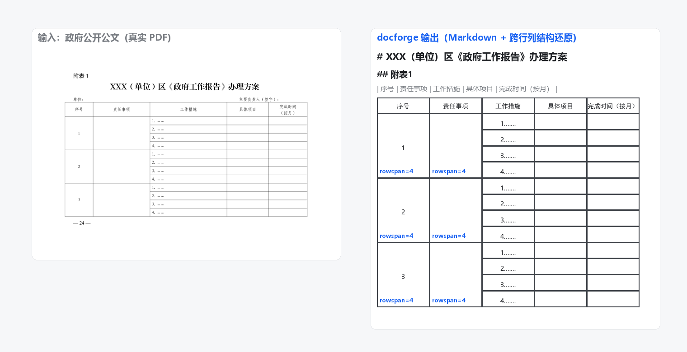
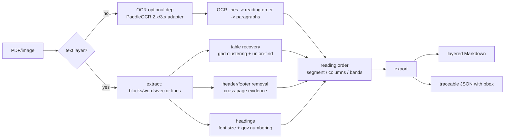

# docforge

**Chinese document parsing engine + open benchmark: multi-column, complex-table and scanned PDFs → LLM-ready Markdown and traceable JSON with bounding boxes.**

[中文说明](README.md)

<p align="center">
  <a href="#-benchmark-leaderboard"></a>
  <a href="LICENSE"></a>
  
  <a href="https://github.com/attnstack/docforge/actions"></a>
</p>

<p align="center">
  
</p>

## Why docforge

If you build RAG pipelines over Chinese documents, parsing is the dirtiest link. Text-layer extractors (markitdown, PyMuPDF4LLM) fail on the three most common layouts:

1. **Two-column papers get interleaved line by line** — measured 0.32 text fidelity on our benchmark;
2. **Merged-cell tables get flattened** — budget/financial reports are full of rowspan/colspan;
3. **Scanned pages have no text layer** — OCR output needs layout reorganization.

docforge handles all three with a fully deterministic, unit-tested pipeline:

- **Reading order**: full-width segmentation → column detection → line-band clustering (pure geometry, no model needed);
- **Bordered table structure recovery**: line-segment grid clustering + union-find merging → HTML with `rowspan`/`colspan`;
- **Scanned pages**: PaddleOCR as an optional dependency, headings recovered from line-height proxies;
- **Dual output**: layered Markdown (feed straight to an LLM) and JSON with bbox/page/reading-order/confidence for traceability;
- **An open benchmark**: CER / TEDS / reading-order accuracy / heading-tree similarity — all deterministic (no LLM judge), with a submission schema and a reproducible leaderboard. Bring your own engine.

## 30-second quick start

```bash
pip install docforge-zh
docforge gen-seed
docforge convert your-file.pdf -o out.md --format both
docforge bench --engine docforge --engine pymupdf4llm
```

Also supported: `--pages "1-3,7"` (page selection), `--password` (encrypted PDFs), http(s) URL input, `--batch` with badcase collection, and a FastAPI server (`docforge server`).

## Benchmark highlights

Full methodology and reproducible numbers: [docs/benchmark.md](docs/benchmark.md) / [中文榜单](README.md#-benchmark-榜单).

| Engine | Text 1−CER ↑ | Reading order ↑ | Table TEDS ↑ | Heading tree ↑ | Overall |
|---|---|---|---|---|---|
| docforge 0.2.0 | 0.8760 | 0.9762 | 0.6667 | 0.8095 | **0.8321** |
| PyMuPDF4LLM | 0.5331 | 1.0000 | 0.2044 | 0.5952 | 0.5832 |
| markitdown | 0.3576 | 0.9667 | 0.0000 | 0.3333 | 0.4144 |

*Dataset `docforge-zh-real-v0.1-rc`: 7 real Chinese government documents (redistributable under Chinese copyright law art. 5), two independent annotation passes with 1.0000 agreement. Small sample — see the honest limitations below.*

On the synthetic seed set, docforge scores 1.0 across the board; PyMuPDF4LLM 0.9017 (ties with us on plain bordered tables, drops to 0.20 on real merged cells); markitdown 0.8021 (0.32 text fidelity on two-column layouts).

## Known limitations (honest list)

- **No borderless tables, no scanned-page table structure** in v0.1/0.2 (needs PP-Structure-class models — on the roadmap);
- **Formula → LaTeX not enabled**: metric implemented, conversion pipeline intentionally off until measured;
- **OCR runtime**: verified natively on Windows; the pinned paddle 2.6 Linux wheel crashes with SIGILL on some AMD CPUs under WSL2 (`import paddleocr` is enough to trigger it — lazy loading keeps digital-only usage unaffected);
- **Small real benchmark**: 7 samples, two-pass single-annotator so far (agreement 1.0000); scaling to 50–100 pages.

## Architecture



Core reading: [reading_order.py](docforge/stages/reading_order.py) · [table.py](docforge/stages/table.py) · [tree_edit.py (Zhang-Shasha)](benchmark/metrics/tree_edit.py) · [benchmark methodology](docs/benchmark.md)

## Contributing

See [CONTRIBUTING.md](CONTRIBUTING.md). Benchmark submissions go through the issue template; the submission JSON must pass the published schema.

## License

[MIT](LICENSE)
